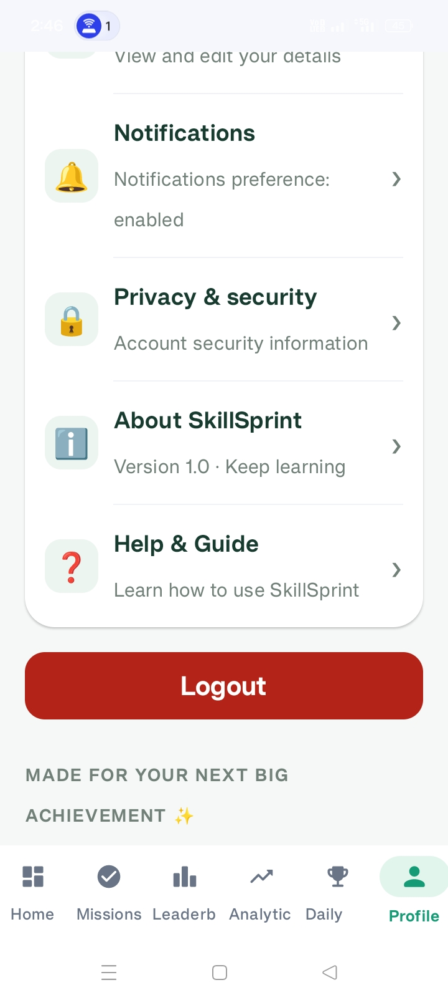

# 🚀 SkillSprint — Learn Smarter, Every Day

SkillSprint is an Android learning and productivity application built with Kotlin and Jetpack Compose. It aims to help users build consistent learning habits, track progress, and organize their daily learning activities.

## ✨ Features

* 📚 **Daily Learning Plan** — Organize daily learning activities.
* 🎯 **Learning Missions** — Track learning tasks and goals.
* 🔥 **Streak Tracking** — Encourage consistent learning habits.
* 📊 **Progress Analytics** — Monitor learning progress.
* 🏆 **Leaderboard** — Compare learning progress with other users.
* 👤 **User Profile** — Manage personal learning information.
* 🤖 **AI Chat** — Access an AI-assisted learning interface.
* 🔔 **Reminders** — Support regular learning routines.
* 🔐 **Firebase Integration** — Authentication and cloud data functionality.

## 🛠️ Tech Stack

* **Language:** Kotlin
* **UI:** Jetpack Compose
* **Platform:** Android
* **Authentication:** Firebase Authentication
* **Database:** Cloud Firestore
* **Build System:** Gradle

## 📱 Project Details

* **Project Name:** SkillSprint
* **Package Name:** `com.krishna.skillsprint`
* **Minimum Android SDK:** 24
* **Development Environment:** Android Studio

## ⚙️ Getting Started

1. Clone this repository:

   ```bash
   git clone https://github.com/krishug8826-max/SkillSprint.git
   ```

2. Open the project in Android Studio.

3. Allow Gradle to sync and download the required dependencies.

4. Configure your own Firebase project and Android app.

5. Add your Firebase configuration file locally as `app/google-services.json`. Do not commit this file to a public repository.

6. Run the app on an Android emulator or a compatible Android device.

## 🎯 Project Goal

SkillSprint is a portfolio project focused on Android application development, modern UI design with Jetpack Compose, Firebase integration, and learning-progress management.

## 👨‍💻 Developer

**Krishna**

Interested in Android Development, Kotlin, Jetpack Compose, and building practical mobile applications.

---

## 📱 App Screenshots

Take a look at the SkillSprint Android app.

<table>
  <tr>
    <td align="center"><b>App Screen 1</b><br></td>
    <td align="center"><b>App Screen 2</b><br></td>
    <td align="center"><b>App Screen 3</b><br></td>
  </tr>
  <tr>
    <td align="center"><b>App Screen 4</b><br></td>
    <td align="center"><b>App Screen 5</b><br></td>
    <td align="center"><b>App Screen 6</b><br></td>
  </tr>
  <tr>
    <td align="center"><b>App Screen 7</b><br></td>
    <td align="center"><b>App Screen 8</b><br></td>
    <td align="center"><b>App Screen 9</b><br></td>
  </tr>
  <tr>
    <td align="center"><b>App Screen 10</b><br></td>
    <td align="center"><b>App Screen 11</b><br></td>
    <td align="center"><b>App Screen 12</b><br></td>
  </tr>
  <tr>
    <td align="center"><b>App Screen 13</b><br></td>
    <td align="center"><b>App Screen 14</b><br></td>
    <td align="center"><b>App Screen 15</b><br></td>
  </tr>
  <tr>
    <td align="center"><b>App Screen 16</b><br></td>
    <td align="center"><b>App Screen 17</b><br></td>
    <td align="center"><b>App Screen 18</b><br></td>
  </tr>
  <tr>
    <td align="center"><b>App Screen 19</b><br></td>
    <td align="center"><b>Profile</b><br></td>
  </tr>
</table>


⭐ If you find this project interesting, feel free to explore the repository!
